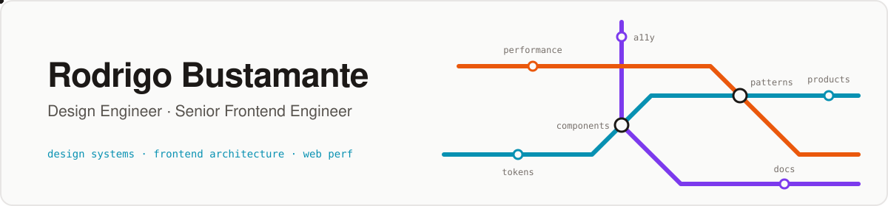
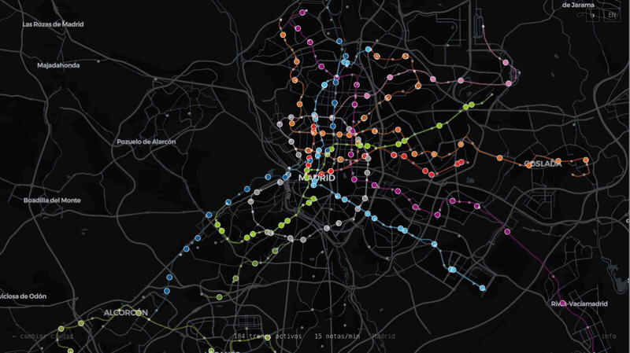
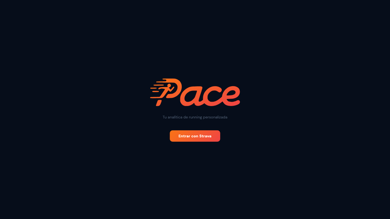
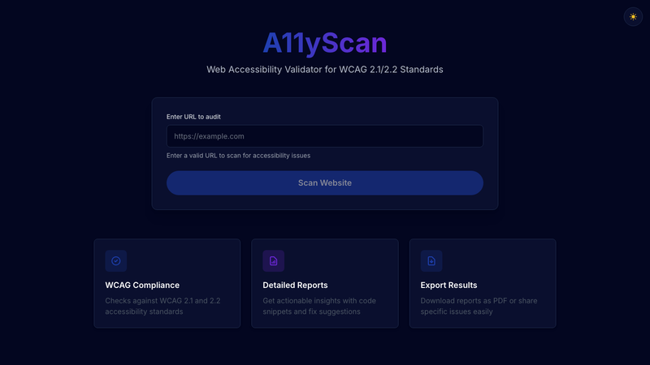

<a href="https://rodrigobustamante.cl">
<picture>
  <source media="(prefers-color-scheme: dark)" srcset="assets/banner-dark.svg" />
  
</picture>
</a>

  I design and build frontend platforms and design systems, from airlines to copper mining.

  🟢 <b>Open to Senior Frontend Engineer roles</b> · Madrid, Spain (remote-friendly)

  
  
  
  
  
   
  
  
  

---

### About me

Computer engineer with **9 years** building web products for retail, payments, healthcare and aviation. I spent the last years at **LATAM Airlines**, where I worked on the airline's home page and later on **[Hangar](https://rodrigobustamante.cl/work/hangar-design-system)**, its design system: boilerplate and components used by **50+ teams** and reaching **millions of passengers**.

- 🏗️ Software Architect at **Vantaz Analytics**, building a supplier management platform for a copper miner (Next.js, FastAPI, Azure)
- 🧩 Focused on design systems, micro-frontends, accessibility and web performance
- 🤖 Building MCPs and Skills so teams and AI agents can work with design systems
- 🌍 Based in Madrid, Spain · Spanish (native) · English (B2)
- ⚡ Off the keyboard: running, tennis, video games and series

### Featured projects

<table>
  <tr>
    <td width="50%" valign="top">
      
      <h4>🚇 <a href="https://github.com/rodrigobustamante/intervalo">Intervalo</a> · <a href="https://intervalo.rodrigobustamante.cl">live demo</a></h4>
      The metro as an instrument: every train in Santiago and Madrid plays a note as it reaches a station, interpolated from GTFS open data.
        Next.js · MapLibre GL JS · Web Audio API · TypeScript
    </td>
    <td width="50%" valign="top">
      
      <h4>🏃 <a href="https://github.com/rodrigobustamante/pace">PACE</a> · <a href="https://pace.rodrigobustamante.cl">live demo</a></h4>
      Running analytics on top of Strava: fitness, fatigue and form, race predictions and an AI coach powered by Gemini, GPT-4o or Claude. Web + iOS.
        Next.js · Expo · TypeScript · Vercel AI SDK · Prisma
    </td>
  </tr>
  <tr>
    <td width="50%" valign="top">
      
      <h4>♿ <a href="https://github.com/rodrigobustamante/a11y-web-validator">A11yScan</a></h4>
      Audits any URL against WCAG 2.1/2.2 with Playwright and axe-core, scores it from 0 to 100 and exports PDF reports. Hardened against SSRF with an egress proxy.
        Next.js · Express · Playwright · axe-core · TypeScript
    </td>
    <td width="50%"></td>
  </tr>
</table>

### Writing

<!-- BLOG-POST-LIST:START -->
- [Speculative Rendering - Enhancing Web Performance](https://rodrigobustamante.cl/blog/en/speculative-rendering-web-performance-guide)
- [Core Web Vitals - Complete Guide for Beginners](https://rodrigobustamante.cl/blog/en/core-web-vitals-complete-guide-for-beginners)
<!-- BLOG-POST-LIST:END -->

➡️ [More on my blog](https://rodrigobustamante.cl/blog/en)

### Tech stack

  
   
  
   
  

Also: React Native, Storybook, Playwright, micro-frontends, CI/CD.

---

  <b>Building a design system or a frontend platform?</b> Let's talk →
  <a href="mailto:rbustamantejelvez@gmail.com">email</a> · <a href="https://www.linkedin.com/in/rod-bustamante">LinkedIn</a>

